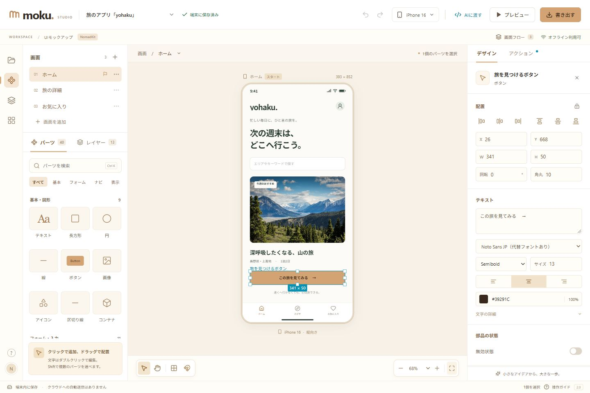

# moku Studio

**思い描いたアプリ画面を、サッと形に。**

moku Studioは、ブラウザーで使える日本語のUIモックアップエディターです。パーツを並べて画面を作り、画面同士をつないで操作を試し、そのまま画像や仕様書を書き出せます。企画のアイデア出しから、チームへの共有、AIを使った実装の準備まで、一つの場所で進められます。

### [moku Studioを使ってみる →](https://moku-ui-editor.vercel.app/)



## moku Studioでできること

| 作る | 試す | 渡す |
| --- | --- | --- |
| **40種類のパーツ**を並べ、文字・色・サイズを編集 | 複数画面をつなぎ、**画面遷移をプレビュー** | 画像、操作できるHTML、AI向け仕様書などを**まとめて書き出し** |

- **アイデアをすぐ画面に** — ボタン、フォーム、カード、ナビゲーションなどをクリックやドラッグで配置。整列、グループ、元に戻す操作にも対応しています。
- **さまざまな画面を想定** — スマートフォン、タブレット、PC、各種アスペクト比など、46種類の画面サイズを用意。カスタム寸法も使えます。
- **操作の流れまで共有** — 画面遷移や戻る操作を設定し、プレビューで確認できます。
- **次の作業につなげる** — PNG・SVG・JSON・HTML/CSS・Markdown・ZIPに書き出し。AI向けの構造化仕様も作成できます。
- **自分のブラウザーで保存** — 編集内容は端末内に自動保存。初回読み込み後はオフラインでも編集できます。

## はじめかた

1. アプリを開くと、旅のアプリを題材にしたサンプルが表示されます。
2. 左側のパーツを追加し、キャンバス上に配置します。選択したパーツの見た目は右側で編集できます。
3. 画面を追加してアクションを設定し、プレビューで動きを確認します。
4. 「書き出す」から、共有や実装に必要な形式を選びます。

> 編集データはブラウザー内に保存されます。別の端末やURLに移すときや、ブラウザーのデータを消去する前は、JSONをバックアップしてください。

---

以下は、ローカル開発や各機能の詳しい情報です。React 19 / TypeScript / Vite / Zustand / Dexieを使用しており、バックエンドや外部APIキーは不要です。

## ローカル起動

Node.js 22.12以降（22 / 24対応）を使用します。

```sh
npm ci
npm run dev
```

表示されたLocal URLを開きます。Windowsでは `起動.cmd` からも起動できます。初回は旅のアプリのサンプルが開き、左上のmokuロゴから空のプロジェクトを作成できます。

```sh
npm test
npm run build
npm run preview
```

## Vercelへのデプロイ

1. Vercelの **Add New → Project** で、このGitHubリポジトリをImportします。
2. Root Directoryはリポジトリ直下、Framework Presetは **Vite** を使用します。
3. `vercel.json` が以下の設定を指定します。

| 設定 | 値 |
| --- | --- |
| Install Command | `npm ci` |
| Build Command | `npm run build` |
| Output Directory | `dist` |
| 環境変数 | 不要 |

`sw.js`は再検証する設定になっており、古いアプリのキャッシュが配信され続けることを防ぎます。GitHub Actionsはpush / pull request時にテストとビルドを実行します。VercelのGit連携でプレビューと本番デプロイを設定できます。

- [VercelのVite対応](https://vercel.com/docs/frameworks/frontend/vite)
- [vercel.jsonの設定](https://vercel.com/docs/project-configuration/vercel-json)

## パーツと画面サイズ

基本・図形、フォーム、ナビゲーション、コンテンツ、通知・状態の5カテゴリ、40種類の部品を用意しています。

テキスト、図形、ボタン、画像、入力欄、チェックボックス、スイッチ、検索欄、複数行入力、プルダウン、ラジオ、スライダー、進捗、バッジ、チップ、アバター、評価、パンくず、ページ切り替え、タブ、アラート、トースト、ツールチップ、折りたたみ、テーブル、サイドメニュー、ダイアログ、数値カード、スケルトン、アップロード枠、ステッパーなどに対応します。

機種・ビューポートの参考値は46種類。iPhone、iPad、Android、折りたたみ、PC、16:9 / 16:10 / 4:3 / 3:2 / 1:1 / 9:16 / 4:5 / 21:9を選べます。検索、カスタム寸法、縦横切り替え、配置済みパーツの拡縮に対応します。物理ピクセルの端末エミュレーターではありません。基準は [catalog-notes.md](catalog-notes.md) に記載しています。

## 編集とプロトタイプ

- クリック追加・ドラッグ配置、移動、8方向リサイズ、回転、色・文字・フォント・枠線・角丸・影。
- 数値・色の入力は確定時に反映し、途中の空欄・負数・小数入力を許容。
- 範囲選択・Shift複数選択、ネストしたグループ、複製、ロック、表示切り替え、整列・等間隔配置。
- 自由配置・縦・横・2列グリッドの自動整列、ズーム・パン、8pxグリッド、端・中心のスナップ。
- 60件のUndo / Redo、矢印で1px移動（Shiftで10px）、Space / Hでパン。
- 複数画面の追加・複製・削除・並べ替え、スタート画面、IDで管理する画面リンク。
- Navigate / Back / Open URL、フェード・スライド、スクロールと固定領域、画面フロー・リンク警告。
- フォームやタブなどの部品はプレビュー内で操作可能。入力値はプロトタイプ確認用で、プロジェクトに自動反映しません。

## 保存・オフライン

編集データ・画像はブラウザーのIndexedDBに保存します。自動保存を順番に実行し、古い書き込みが新しい編集を上書きしないようにしています。現在の画面・選択・ズーム・グリッドも復元します。保存に失敗したときは、画面上にエラーとJSONバックアップ操作を表示します。

HTTPS環境またはlocalhostで本番ビルドを初回オンライン起動すると、アプリ本体・画像・すべての編集パネルをキャッシュします。「オフライン利用可」が表示された後は、通信がなくても起動・編集・書き出しを続けられます。開発サーバーではService Workerを登録しません。読み込み中はスケルトンを表示します。新しい版は「保存して更新」から適用します。

URL・ブラウザー・端末が変わると保存領域も変わります。別の端末や新しい公開URLへ移す場合は、先にJSONを書き出し、新しい環境で読み込んでください。ブラウザーデータを消去する前にもバックアップしてください。

## 書き出し

| 形式 | 内容 |
| --- | --- |
| PNG | 通常2倍の画像。大きな画面・長尺はメモリー上限に合わせて倍率を調整 |
| SVG | HTMLをforeignObjectに埋め込んだSVG。対応ブラウザー向け |
| JSON | 画像を埋め込んだ編集データ。初期版JSONも読み込み可能 |
| HTML / CSS | ネット接続なしで開けるプロトタイプ。画面遷移・フォーム操作・表示倍率 |
| Markdown | 寸法、階層、文字、フォント、色、配置、動作、補足を含むAI向け仕様 |
| ZIP | 上記の主要ファイル、PNG、重複を除いた画像、対応表manifest、説明書、実装プロンプト |

全画面・現在の画面の範囲を切り替えられます。範囲外の遷移先は警告を表示し、データを無断で削りません。HTMLは絶対配置を使った参考コードで、業務ロジックや最終レスポンシブ対応は実装時に調整します。画像はPNG / JPEG / WebP / GIF、1枚5MBまで。JSONは50MBまでです。

## デザインと現在の範囲

配色・表示規則は [DESIGN.md](DESIGN.md)、元の企画仕様は [SPECIFICATION.md](SPECIFICATION.md) を参照してください。既存プロジェクトの色や文字を、アプリ更新時に勝手に変更することはありません。

共同編集、クラウド同期、コメント、汎用ベクターパス編集、レスポンシブブレークポイントの編集は対象外です。画面フローはカードと遷移一覧で、自由に配置できるノードグラフではありません。グループ固定は画面直下の要素に対応します。サンプル写真はUnsplash配信のイメージで、地名との実写対応は保証しません。

## 検証

38件の自動テストで、全40部品の描画・スキーマ、46プリセット、初期版の互換性、入力検証、階層座標、ロック、Undo / Redo、整列・等間隔、保存キュー、画像出力サイズ、HTMLのエスケープ、オフラインキャッシュ生成を確認します。ブラウザーでは編集、入力、遷移、JSON再読込、ダウンロードと狭い表示を確認しています。

## ライセンス

このプロジェクトは [MIT License](LICENSE) で公開しています。依存ライブラリおよびサンプル写真などの第三者素材には、それぞれのライセンスや利用条件が適用されます。
